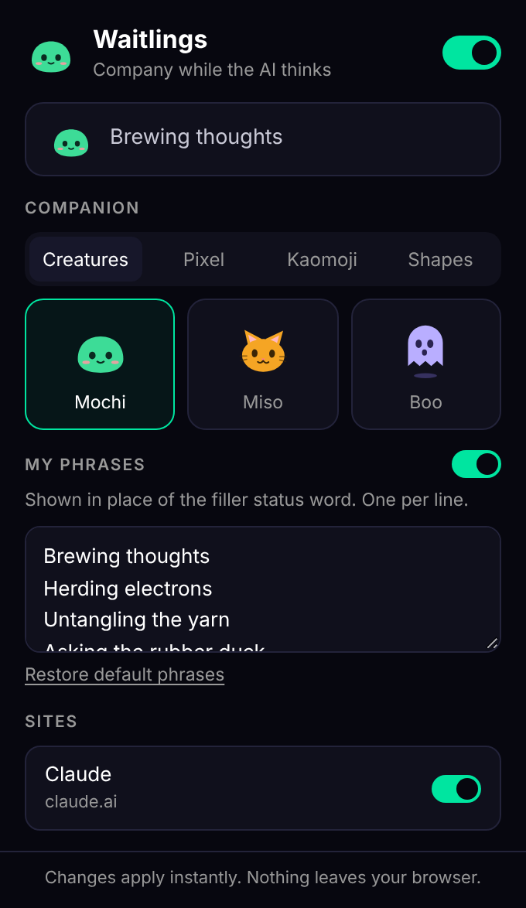
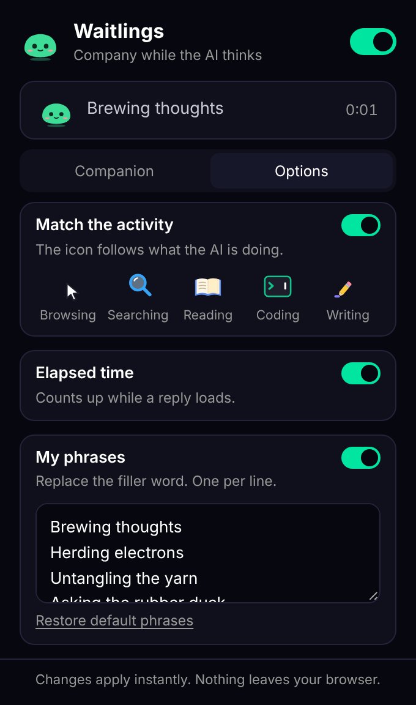

# Waitlings

A browser extension that swaps the loading indicator in AI chat apps for a small animated companion and your own status phrases.

Version 0.2.0 comes in two forms that share the same artwork:

- **Browser extension** for claude.ai in Chrome, Brave, Edge and other Chromium browsers. ChatGPT and Gemini are next on the roadmap.
- **Claude app plugin** for the Claude desktop app (Cowork and Claude Code sessions). See [Claude app plugin](#claude-app-plugin).

 

## What it does

While an AI app is preparing a reply it shows a small animation and a filler status word. Waitlings replaces both:

- **The animation** becomes one of 12 companions across 4 packs: Creatures, Pixel, Kaomoji and Shapes, in 3 sizes.
- **The icon follows the activity.** When the status line says what the AI is doing, the companion steps aside for a matching icon: a book for reading, a magnifier for searching, a cursor for browsing, a terminal for running code, a pencil for writing.
- **An elapsed-time counter** runs beside the icon for the length of the reply.
- **The filler word** becomes a phrase from a list you write yourself. 10 defaults are included.

Real progress text, such as "Checking the weather", is left as the site shows it.

## Install

Waitlings is not on the Chrome Web Store yet. It loads directly from this folder and works in Chrome, Brave, Edge and other Chromium browsers.

1. Download the code: click **Code > Download ZIP** on GitHub and unzip it, or clone it:
   ```
   git clone https://github.com/aneeshk-ds/waitlings.git
   ```
2. Open the extensions page: `chrome://extensions` in Chrome, `brave://extensions` in Brave.
3. Turn on **Developer mode** (toggle in the top right corner).
4. Click **Load unpacked** and select the `waitlings` folder (the one that contains `manifest.json`).
5. Reload any open claude.ai tabs.

To update later, pull or download the new code and click the reload arrow on the Waitlings card on the extensions page.

## Claude app plugin

Browser extensions cannot reach the Claude desktop app, so the app has its own version in the [`mod/`](mod) folder. It uses the app's plugin system to draw the companion in place of the loading row, and it picks activity icons from the tool that is running, which is more exact than matching words.

Install it one of two ways:

- **In the desktop app:** click + next to the prompt box, then Plugins, then Add marketplace, and enter `aneeshk-ds/waitlings`. Then choose Add plugin.
- **In a terminal session:**
  ```
  /plugin install waitlings --marketplace aneeshk-ds/waitlings
  ```

Then type `/waitlings` to open its settings. Details are in [mod/README.md](mod/README.md).

## Use

The rest of this page covers the browser extension.

Click the Waitlings icon in the browser toolbar (pin it from the puzzle-piece menu if it is hidden).

| View | Control | What it does |
| --- | --- | --- |
| Top | Main switch | Turns Waitlings on or off everywhere |
| Companion | Pack and companion | Pick a pack, then a companion |
| Companion | Size | Small (24 px), Medium (30 px) or Large (38 px) |
| Companion | Sites | Turn Waitlings on or off for a single site |
| Options | Match the activity | Swap the companion for an activity icon when the status text names one |
| Options | Elapsed time | Show or hide the counter |
| Options | My phrases | One phrase per line. The switch turns phrase swapping off and keeps the site's own word |

Changes apply to open tabs straight away. No reload is needed.

## Companions

| Pack | Companions |
| --- | --- |
| Creatures | Mochi (blob), Miso (cat), Boo (ghost) |
| Pixel | Heartbeat, Slime, Ember |
| Kaomoji | Shades, Dance, Sleepy |
| Shapes | Orbit, Bars, Ripple |

### Activity icons

| Icon | Shown when the status text starts a word with |
| --- | --- |
| Cursor (browsing) | brows, navigat, click, scroll, visit |
| Magnifier (searching) | search, look up, find, check, query |
| Book (reading) | read, fetch, open, scan, review, view |
| Terminal (coding) | run, execut, cod, debug, test, analy |
| Pencil (writing) | writ, draft, creat, edit, summari, build |

The first matching row wins. Text that matches nothing keeps your companion. The full word lists are in `src/core/activities.js`.

All artwork is original and drawn in code as SVG or text. The repo contains no third-party images.

## How it works

Waitlings never edits the page's own elements. It adds two `<style>` tags and does everything with CSS:

1. A site **adapter** lists the CSS selectors for the site's loading indicator.
2. The stylesheet hides what is inside that indicator and draws the companion on a `::after` pseudo-element in the same spot.
3. A small timer updates CSS custom properties: the current phrase, text frame, activity icon and elapsed time. While the page is idle it only checks whether a reply has started.

Because no page elements are added, moved or removed, the site's own framework is not disturbed and a re-render cannot knock the companion out.

```
manifest.json
src/
  core/
    defaults.js    settings, storage helpers
    themes.js      the 12 companions
    activities.js  the 5 activity icons and their trigger words
    css.js         builds the stylesheet from an adapter and a theme
    engine.js      content script: applies styles, picks the icon, keeps time
  adapters/
    claude.js      selectors for claude.ai
  popup/           the settings popup
mod/               the Claude app plugin (TypeScript hooks module, tests)
tools/
  sync-mod-art.js  regenerates mod/hooks/art.ts from src/core
docs/
  adding-a-site.md
```

## Privacy

- The only permission requested is `storage`, used to save your settings in your own browser.
- No network requests, no analytics, no accounts.
- The extension does not read your conversations. The one piece of page text it reads is the short status line beside the loading icon (for example "Searching the web"), to pick an activity icon. That text is matched against a word list inside the extension and is never stored or sent anywhere. Turning off **Match the activity** stops the read.
- Screen-reader announcements made by the site are left untouched.

## Known limits

- **Sites change.** No AI app offers an official way to restyle its loading indicator, so each adapter depends on the site's current markup. When a site ships a redesign the companion may stop appearing until the adapter's selectors are updated. Nothing else breaks: the site falls back to its normal indicator.
- **The extension is browser only.** The desktop app is covered by the plugin in `mod/`. The mobile app is not covered by either.
- **Claude coverage.** Verified on the claude.ai chat view. Other views may use different markup and are not covered yet.
- **Activity matching is by keyword, in English.** Status lines are free text written by the model, so some will match the wrong icon or none. Unmatched lines show your companion.
- **The counter is Waitlings' own clock.** It starts when the loading icon first appears, so it can differ from a site's own figure by about a second.

## Roadmap

- ChatGPT adapter
- Gemini adapter
- A clock or hourglass companion
- More activity icons, and companions that hold props
- Bring your own image or GIF
- Chrome Web Store listing

## Add a site

Supporting a new site means writing one small adapter file. See [docs/adding-a-site.md](docs/adding-a-site.md).

## Licence

MIT. See [LICENSE](LICENSE).

Waitlings is an independent project. It is not affiliated with or endorsed by Anthropic, OpenAI or Google.
